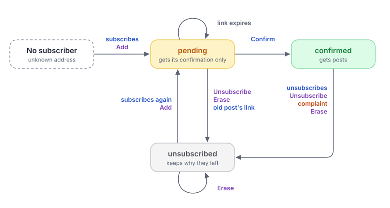

# Kestrel Specification

The high-level, abstract description of Kestrel, the newsletter app. It describes what the system is, what it guarantees, and how it's shaped, not how it's built. The concrete schema lives in `migrations/`, the routes in `src/app.ts`, and the code's structure in `src/`; this document does not restate them.

**Who this is for.** The implementer and the maintainer, human or Claude, and anyone deciding whether Kestrel's guarantees fit their newsletter. It is written for a cold reader: a term defined elsewhere carries a pointer to where.

**Status.** A living document that tracks `main`. The rule for keeping it in step with the code is `.claude/rules/maintainer.md`.

**How to read it.** §1 to §3 are the contract: what the app is, the kind of application it is and the principles that follow from that, the six nouns, and the six invariants. §4 to §12 walk each area of the system. The appendix records what was decided, with the alternative each choice was made over, what the app trusts to the people who run it rather than guarding in code, and what was deliberately deferred. The shape of the API itself, the rules every route follows, is `docs/API.md`.

---

## 1. What this is

An application for writing a newsletter and sending it to subscribers. The publisher writes a post in Markdown, sees exactly what the email will look like, and schedules it for a future date and time, usually days out. Until it fires, the scheduled post stays visible and cancelable; the publisher reviews it in that window, and then it goes out on its own. The app keeps the subscriber list, remembers what it sent, and preserves each post as a permanent page.

Three roles appear in this document. The **publisher** writes posts and sends them. The **developer** deploys and runs the app. The **reader** subscribes and receives the newsletter. One person is often both publisher and developer; the document names the role, not the person.

The foundation that makes all of this work is a single HTTP API. Everything the publisher does reaches Kestrel through it, and it has exactly two clients: a **web editor** the publisher drives by hand, and **Claude**, working the same API on their behalf. Both do the same work through it, so Claude does nothing the publisher couldn't do in the editor, and neither reaches past what the API exposes. One API over one copy of the data keeps the two from ever drifting apart. Two other parties reach the app without touching that authoring surface: readers, through a small set of public pages (subscribe, confirm, unsubscribe, and the archive), and the email provider, which reports delivery outcomes back through signature-verified webhooks.

![The publisher drives the web editor and asks Claude, and both reach Kestrel only through its authoring API, which reads and writes the database and object storage and hands email to the email provider. The provider delivers it to readers, who come back through the public pages (subscribe, confirm, unsubscribe, and the archive), which read the same store. The provider reports deliveries, bounces, and complaints through signed webhooks, which record them in the store without passing through the authoring API.](spec-overview.svg)

Content lives in the app's own database, with every version of a post kept as a revision. Images are uploaded to a post and referenced by name; the publisher never touches an upload URL. Every send freezes the rendered email, and that frozen copy *is* both the reader's post page, where an email's "view in browser" link leads, and the permanent record of what went out.

### What it isn't

- **Not a general CMS.** It serves the newsletter's own reader surface (a home page, the archive index, and the per-post pages), and only that. It doesn't author arbitrary pages or replace the publisher's website or blog.
- **Not multi-channel.** Email only. Cross-posting to a website, RSS, or social is out of scope.
- **Not a marketing automation suite.** No drip sequences, funnels, or A/B campaigns. One post, reviewed, sent to the list.

### The kind of application this is

Kestrel is for **one publication run by one person**. The publisher is usually also the developer who deploys it, and both of its clients, the editor and Claude, act for that same person. The list runs from hundreds of readers to tens of thousands, a post goes out a few times a month, and a whole publication's history is hundreds of sends, not millions. It is self-hosted on a small platform budget, and no one is paid to watch it.

Those facts decide where the app spends its care, and every rule in this document follows from one of these principles:

- **Guard what cannot be undone or will not be seen.** Mail that has left, consent, and the record of what went out cannot be taken back, and a mistake in them may go unnoticed until a reader complains. These are the invariants (§3), and code enforces them however the app is driven.
- **Make plain what can be undone.** Most of what the publisher does before a send fires can be reversed: a canceled send can be scheduled again, a moved fire time moved back. When two acts meet, as when the editor and Claude act on the same send moments apart, the app answers each one honestly and shows the result, rather than refusing one to prevent a race. Both acts come from the same person, and the review window (§6) is there for noticing. Where a lost change would be silent and costly, such as one writer's edit overwriting another's prose, the app does refuse, and says why (§4).
- **Trust the developer's deliberate acts, and say how to do them safely.** What the developer changes at deploy time (the provider, the credentials, the origins, the upgrade path) is theirs to time. The app checks that a configuration is valid (§9), but it does not follow the developer's changes across time to second-guess them. Where the timing matters, the setup guide says so. The appendix lists what is trusted this way.
- **Build for this scale.** A mechanism earns its place by a failure that can happen at the scale above, and happen often enough, or badly enough, to matter. A case that needs a rare coincidence, and would harm a handful of readers when it happens, is written down rather than engineered around.
- **One API, and the server decides.** Both clients see the same facts and the same choices because the app works out what a send's state means, what is wrong with it, and what can be done to it, once, and both clients show that answer (§8). The API is kept small enough that either client can learn it from its reference. A concept on it earns its place by changing what a client shows or does. `docs/API.md` holds the rules for its shape.

---

## 2. The model

Six nouns make up the whole domain: the first three are content, the last three are the audience and the record.

**Post** — one piece the publisher writes and sends: a Markdown body plus its metadata, editable while a draft, frozen once scheduled, and closed once sent. Its metadata is a **subject** and a **slug**. The subject is the email's subject line, and it also names the post in the list and seeds the slug. The slug is the post's address in the archive, once it has one (§4). The subject is the one field that must be set to send. Beside its metadata a post carries its **listing**: **in the archive**, the default, or **email only**, mailed as usual but left out of the public lists of posts (§5). Every post also has its own **unlisted link**, made with it and never changed, which every email of it carries as its "view in browser" link (§5).

**Revision** — a saved version of a post's Markdown and metadata. Every save writes one. This is the versioning that files would have given for free, handed back deliberately.

**Image** — a file belonging to a post, referenced by name in the Markdown. The app stores it, sizes it, and resolves it to an absolute URL at render time.

**Subscriber** — an email address with a consent state: pending, confirmed, or unsubscribed. Only confirmed subscribers receive sends. Beside the state, a subscriber carries how they joined (through this app's double opt-in, or carried in with a list brought from elsewhere) and, once they have left, why (§7).

**Send** — one dispatch of a post, created the moment the post is scheduled, not when it fires. It holds the frozen render, the fire time, and after firing, who it reached and how it went. Its frozen render can be made again only while the send is scheduled, and only as the publisher's deliberate act (§6); once it has fired it is never rewritten, while its outcomes keep settling as receipts arrive (§6). The word is both the verb and, like *build* or *deploy*, the noun for one instance of it; the article tells them apart, and *a send* always means this record.

**Suppression** — an address that must not be mailed, whatever its consent state, because of the sender's side rather than the person's: one that hard-bounced, or one the publisher blocked.

### The lifecycle

A post has three states and a send has four, and the two advance on different clocks: the post's state says whether it can be edited, the send's says how far the dispatch has gone.

| Post | Send | What it means |
| --- | --- | --- |
| **draft** | none | Being written. Editable. |
| **scheduled** | **scheduled** | Scheduling makes the email (§6): the render is frozen onto a send and the post is locked. The send is visible and cancelable until it fires: this is the review window (§6). |
| **scheduled** | **sending** | The send has fired and is delivering. The post's state holds, but it is past the window: it can no longer be edited or canceled. |
| **sent** | **sent** | Dispatch is complete. The send is the permanent record of what went out, and the post is closed. |
| **draft** | **canceled** | The publisher canceled the send during its window. The post is unlocked and editable again; the canceled send stays as a record but is no longer active. |

Only one send per post can be active (scheduled or sending) at a time (§6), so the pair above is always unambiguous. Scheduling a draft again after a cancel creates a new send; the old one is history.

---

## 3. Invariants

Six guarantees. In a newsletter the guarantees that matter are about consent, delivery, and the record. Every rule about sending, consent, and the record in this spec upholds one of these.

**I1 — Nothing is sent without recorded consent.** Only confirmed subscribers receive a send. A subscriber is confirmed when their consent is on record in one of two ways: they confirmed here by double opt-in, or they opted in at another service and were imported with that service's record of it and the publisher's word that they opted in (§7). Either way, every delivery traces back to a record of how the person consented and, where that record shows it, when.

**I2 — Unsubscribe is immediate and final.** From the moment an unsubscribe is recorded, no further mail reaches that person: a send already in flight skips them if they have not yet been handed off to the provider, and no later send includes them. There is no window in which they still get one, and it is never silently reversed.

**I3 — What went out is preserved exactly.** Every send freezes its rendered HTML. The reader's post page, where an email's "view in browser" link leads, and the permanent record are that same frozen copy, not a re-render, which could differ. Any public chrome an archived post carries (§5) never rewrites the reviewed content.

**I4 — A post is sent at most once per send, to each person at most once.** A repeated trigger never creates a second send (a second send-now finds the existing one; a second schedule is refused, §6), and a retry, a double-click, or a resumed send never mails anyone twice.

**I5 — A test is a real test.** The email the publisher sends themselves to check is produced by the same render path as the email that goes to the list. A clean test is a guarantee, not a lookalike.

**I6 — Nothing is delivered without a window to stop it.** Every send becomes a visible, cancelable send before any mail leaves, for as long as the publisher scheduled and never less than the **minimum lead** (§6). Nothing fires the instant it's requested. This window is the review.

### What follows

- **The schedule is the safety.** Because a send exists as a cancelable send before it fires, a person and Claude can prepare one unattended and still have a window to catch a mistake (I6). This is the newsletter's place where something irreversible is visible before it happens.
- **The archive is the record.** There is no separate "what did the email look like" store to build later (I3). The page a reader opens is the artifact, and it's the very copy that was reviewed.
- **Consent is data the publisher owns, and can prove.** Not a setting on a provider they'd have to trust and can't export (I1).
- **A resend is always safe.** Because a send tracks who it reached, a failed or interrupted send resumes instead of starting over (I4).

---

## 4. Authoring

The publisher writes in Markdown, in the web editor or through the API. Both do the same thing: they read and write posts and their revisions. A post is a **subject** and a body; the **slug** (derived from the subject unless set by hand, below) rounds out the metadata, and the inbox **preheader** (the snippet a mail client shows beside the subject) is derived from the body at render time. A post is editable only while it's a draft; scheduling locks it (§6).

Subject is deliberately the primary field. For an email that is what the reader sees in their inbox, so it is also what names the post in the editor's list and what seeds the slug: one field carrying the weight rather than a separate "title" that would have to be kept in sync with it.

### Revisions, concurrent saves, and images

Every save writes a revision holding the whole post as saved, so every earlier version reads back as it was written. The editor and Claude, or two tabs, can have one draft open at once, so a save names the revision it was made from, and one made from a revision the post has since moved past is refused rather than overwriting the newer one: the refusal carries the post as it stands and who wrote its newer revision, so no one's words are lost without their knowing.

Images are uploaded to the post they belong to and referenced by name in its Markdown; the render resolves each name to the image's address, so the publisher never handles an upload URL.

### Slugs

A slug is the post's address in the archive, `<archive>/<slug>`, and no two posts share one, drafts included. A post holds its slug from its first save, so a duplicate is caught while the publisher is there to choose another, never at the send, when no one is watching and nothing could be done but rename the address silently. Holding it from the start costs little now that no email carries it (every email links through the post's unlisted link, §5): the slug can still change through drafting and scheduling, and is fixed only once the post's send starts, when links to it may begin to be shared. An email-only post holds its slug too, though its address doesn't answer, so adding it to the archive later brings back the same address.

A slug either follows the subject or is set by hand, and the post records which. A slug that follows the subject is derived from it again on every save of the draft, so it tracks subject edits, and when another post already holds the subject's slug it takes the first free number after it (`spring-update-2`) and says which slug it couldn't take, so the publisher can choose another. A post already on a number of its subject's slug keeps it, so a save never moves it from one number to another. A slug set by hand is kept exactly as written until the publisher changes it, and it is checked when it is set: one that isn't lowercase letters and numbers in words joined by single hyphens, or that another post holds, is refused with a message and nothing is saved, never rewritten into something else. A new post's slug follows its subject unless the post is created with one; setting a slug sets it by hand, and either client can have it follow the subject again. The slug is not part of the frozen email, so a scheduled post's slug can still change, with its listing (§5), while its subject and body are locked (§6). Once the post's send starts its slug never changes, since links to it may have been shared, and neither does a scheduled post's whose frozen email already links its archive address, as one frozen before unlisted links does (§5).

The server decides the slug and answers every save with it, and with the subject's slug it couldn't take, so neither client works one out for itself: what the editor shows is the slug the post has.

---

## 5. Preview and the reader surface

Before a post goes out, the publisher can look at it three ways, all the same render aimed differently.

**Preview** — the post rendered as the email, on a page in the editor, behind the admin gate: a live render of the current draft before scheduling, the quick way to check layout, and the frozen copy that will fire once scheduled.

**Web version** — the post as its public post page will show it, for the publisher to proof before the page is permanent. It sits beside the preview, behind the admin gate until the post is published, and shows the same copy the preview shows (a live render of the current draft, or the frozen copy once scheduled) with the edits the post page makes (below): the template's email-only parts left out and the browser-only chrome added. Apart from the page itself, it says that it is the web version and not public yet, so it is never mistaken for the live page. Once the post's send starts, the public post page is the web version, and that is where it leads, through the post's unlisted link.

**Send test** — the real email, rendered and delivered to an address the publisher names, so they can see it in an actual mail client where the rendering finally counts. A test comes in two shapes, both through the one render path (I5): a **post test** sends a specific post; a **template test**, from the template's settings surface (§9), sends a sample post so the publisher can proof the *layout* without picking a post. A template test always renders the **saved** template, the one that will ship, saving any pending edits first. Once a post is scheduled, a post test sends its **frozen copy**, exactly as the fire path will, so the test and the preview never disagree about what is going out. Preview and test each say what the render found wrong with the email, such as an image the post references but never uploaded, and a frozen copy keeps what its render found, so a clean test of a scheduled post means the copy that will go out is clean. The default recipients (§9) pre-fill both. A test the provider doesn't take says why, to the editor and to Claude alike: the provider's own words, then the fix where it is known (as for a send the provider refuses, §12), so a refusal that sending again can't change never just invites another try. A test the provider never answers says it may have arrived, never that the server failed.

Every email carries a **"view in browser" link**, the post's **unlisted link**: an address on the app's own origin with an unguessable token, made with the post and never changed. Every test and every send of the post carries it, never the archive address, for three reasons: the link works whatever the post's listing, it can't be guessed from the subject, and it lives apart from the archive's origin and base path (§11), so moving the archive breaks no email already sent. It is public to anyone who has it, but unlisted: no list, search engine, or page of the site points to it, and it is never called private. Opening it changes nothing, since mail clients' link scanners follow every link in a message before any reader does.

What the unlisted link opens follows the post. Before the post's send starts it lands on the page every address without a published post shows, so it reveals nothing about a post that is scheduled. From the moment the send starts, while the post is listed it forwards to the post's own archive address, temporarily, since the listing can change, and never anywhere a request names, so it can't serve as an open redirect; while it is email only, it is the post's page itself, which asks search engines not to index it. In the publisher's preview the link opens the post's web version until the post is published.

A post is **published** when its send starts, not when the send finishes. The review window closes at the fire time (§6), and a send in flight can't be canceled or ended, so the frozen copy is final the moment the send starts; the link in an email has to work when the email lands, even on a list large enough that the last email goes out long after the first. A send held up in flight (retrying, halted on the provider account, or wedged awaiting Resolve, §12) keeps its post published, since some readers may already have the email, and the link in every email has to resolve from the moment any of them could land. A post's publish date is when its send started.

There is exactly **one render path**. It turns a post into the email, and the preview, the test, and the real send all call it. That's what makes I5 hold: if the test looks right, the send is right, because they're the same code producing the same output. Email rendering is client-dependent enough that a faithful web preview isn't sufficient on its own, so the test is the thing the publisher trusts before scheduling, and the preview is the convenient first look.

### The public reader surface

Because the app is self-contained (§11), it serves its own reader-facing pages, not only per-post archives, and the publication identity (§9) themes them, so the reader surface reads as *the publication*, not the tool. When the publication has a logo, every reader page, post pages included, uses it as the browser tab's icon; with none, the page names no icon and the browser shows its own, never the app's mark. A reader browses three public pages, all indexable (but an email-only post's page, below) and none ever bouncing a visitor toward an admin path (§11):

The **home page** is the newsletter's landing page, the front door at `/`, the one page a reader reaches by typing the bare domain. It carries the identity and a subscribe call to action, features the latest post listed in the archive, lists recent ones, and links into the full archive.

The **archive index** lists every published post listed in the archive, newest first, each linking to its post page. It lives at the archive base path (§11), the same prefix the post pages sit under, so the list and the posts it links to share one origin and one configured path. It carries the same identity and subscribe call to action as the home page.

A **post page** serves that post's frozen render (I3). When the archive lives on the app's own origin rather than inside a surrounding website, the page may add light public chrome (a masthead with the newsletter name, or "Archive" when it has none, and the publish date, a link back to the index, a subscribe prompt, the publication's display font and background, and its logo as the tab icon), so a shared post reads as part of a publication and not a raw forwarded email. That chrome fills reserved anchors the render leaves in the frozen copy, the same idea as the per-recipient placeholders (§6, §9), so it appears only in the browser, never in a sent email, and the reviewed content is served unchanged (I3). The per-recipient slots are filled for no one: the unsubscribe link becomes the generic subscribe-management link, and the sent-to address is left empty so no reader's address is ever shown. The page also leaves out the template's **email-only** parts (§9): the render keeps them in the frozen copy between inert markers and every email carries them, so the record is still the whole sent copy, and the web copy drops only inbox furniture, such as an unsubscribe link for a reader who may not be subscribed, a "view in browser" link to the page itself, and the mailing address. The sign-off is not email-only: it is what readers received, so it shows the identity as it was sent, while the masthead, which is navigation, shows the publication as it is now. A post's archive address is built from the configured archive origin and base path (§11), and is the address a listed post is shared and found by.

An **email-only** post (§2) is left out of the archive index and the home page, and so is any later public list of posts, such as a feed, and it has no archive address that answers. It is mailed exactly as a listed post is, and its page answers at its unlisted link, unchanged, so the email's "view in browser" link works, but asks search engines not to index it. Anyone with the email can still open it. This is for a post meant for the inbox rather than the web: a correction to an earlier email, a short-lived notice, or a test send that proves a new instance without becoming its publication's first post. The listing is not part of the frozen render, which carries the unlisted link whatever the listing: it decides what the lists show and whether the archive address answers, so changing it never re-makes a scheduled send's email or alters a sent one (I3). It is chosen while the post is a draft, or when it is scheduled or sent now, and can be changed at any time after, while the post is scheduled or once it is sent. Either direction is allowed on a sent post, since listing is reversible, and both ask the publisher first. Making a sent post email only takes it off the lists and takes its archive address down: the address answers the page for a post that isn't there, so links people shared stop working, while the email's own link keeps working. The address stays the post's (§4), so listing it again puts it back at its publish date, at the same address, and those shared links work again. A sent post that was never listed is added at the slug it was sent with.

**The archive address answers only while the post is listed and published.** Before a post's send starts, and while it is email only, it answers the page for a post that isn't there. The one exception is a post sent before unlisted links existed: its emails carry its archive address as their "view in browser" link, so that address answers whatever its listing, with the email-only page's request not to be indexed while it is email only. The record of which address a send's email carries is kept with each send, so this holds for every email already out.

The pages a reader reaches from an email to join or leave (confirm and unsubscribe), and the one shown for a post that isn't there, carry the same identity but are never kept by a shared cache or offered to search engines, since some show the reader's own address.

A reader page that fails on something nothing handled shows a plain page saying something went wrong, never the error body the API gives a machine. It names nothing about the cause and reads nothing of the publication, since what failed may be the database itself, and no cache keeps it. The failure is logged for whoever reads the logs (§12).

The publisher can see every page a reader can land on, in each of its states, without walking the flows that reach them: the subscribe, confirm, and unsubscribe pages (the expired and invalid links among them), the home page and the archive index (with posts, and before anything is sent), a post page, and the page for a post that isn't there. Each is built by the code that serves the real page, with the publication's identity and sample values in place of any reader's address or post, behind the admin gate, and framed by the settings surface as a preview so it is never mistaken for the live page. Nothing on a preview acts: it subscribes, confirms, and unsubscribes no one.

No script runs on a reader page, and none can be framed by another site. A post's body is the author's HTML, written by hand or by Claude from material it read, and it is served from the same origin as the admin surface, so the page itself forbids script rather than trusting the render to have removed it. For the same reason nothing in a post can submit a form or send the reader elsewhere on arrival: a form on that origin would act with the publisher's session. The publisher's preview holds to the same rules, and so does the template's sample email on the Template page and in Settings: the template is HTML too, which Claude may write, and it is shown on the admin surface's own origin.

On a local dev instance only, every public page also carries a small, clearly marked shortcut into the editor, a developer convenience that is structurally absent once deployed. Whoever sees a local instance is its developer or publisher, never a reader. On a post page it is browser-only chrome, so it is never in the frozen copy or a sent email (I3). It is the one deliberate exception to never linking toward admin, allowed because a local instance has no access wall in front of the editor (§11).

---

## 6. Scheduling and sending

Sending is built around a review window, because the window is what makes it safe to prepare a send days ahead, by hand or with Claude, and let it go out unattended. **Scheduling is the main path; sending immediately is the deliberate exception.**

### Scheduling a post

Scheduling **makes the email**. It does three things at once: it **freezes the render** into a new send (the one copy that is the review artifact, what will fire, and the archive, I3), it **soft-locks the post** so it can't drift from what was reviewed, and it **records the fire time**. The frozen copy captures three inputs as they stand at that moment: the post's content, the email template (§9), and the publication identity. The content reaches a scheduled send afterward only by cancel, edit, and schedule again. Scheduling also sets the post's listing, in the archive or email only, and may set its slug (§4, §5), checked before anything is frozen, so a refused slug schedules nothing; neither is one of the frozen inputs, so both can be changed afterward without a freeze. A change to the template or the identity **re-makes every scheduled send at once**, after the publisher confirms it, so no scheduled send is ever on an older template or identity than the one in use (§9).

The fire time must be at least the **minimum lead** out; the freeze rejects anything closer, so every send, however requested, spends at least that long visible and cancelable (I6). A fire time is **to the minute**, rounded up when it is not, so the time every client shows is when the send actually goes out, and rounding only ever lengthens the window. The lead is one app-wide interval, set per deployment within bounds: never shorter than the sweep's cadence, and never so long that it stops being a review window and becomes a hold on every send. It is deploy-time configuration, never a preference, because the API is also Claude's door: a review window Claude could shorten through the API would be no guard against Claude. From then until its fire time the send is **visible and cancelable** (I6): the publisher and Claude review it, test emails go to real inboxes, and if anything is wrong the publisher cancels it. The window closes at the fire time itself, not when the sweep gets to the send.

A post **must have a non-empty subject** to schedule or send. The subject is what the reader sees in their inbox and a send is irreversible (I4), so the freeze rejects an empty or whitespace-only subject before anything is frozen, the same guard for both clients, whatever the editor shows beforehand. An empty body is warned about, not blocked.

### The soft-lock

A scheduled post is locked: the API refuses every write to its content (body, subject, images) until its send is canceled, so the lock is enforced, not merely shown. Its settings, its listing and its archive address (§4, §5), are not part of the email, so they stay editable while it is scheduled. The refusal names the way out only where there is one: a cancel unlocks the post until its send starts, after which nothing does, and a sent post stays locked for good. It is *soft* only in that a cancel undoes it. To change it the publisher **cancels** the scheduled send, which unlocks the post, then edits, re-tests, and schedules it again. Editing stays easy but becomes deliberate, and it resets the review.

A **re-make is a freeze**. It renders each scheduled send again from the same locked content, the current template, and the current identity, at the same fire time; it resets the sign-off, so the last approving test should be of the re-made copy; it is refused while any scheduled send is inside the minimum lead, as a move is, because it would leave less than the minimum window to review what it produced (I6); and it never touches a send that is sending or sent. The identity is not versioned: renaming the publication is a global act and reaches scheduled sends the same way.

The guarantee: *what fires is exactly what was last frozen, and a freeze is always the publisher's deliberate act*: a schedule, a schedule again after a cancel, or a confirmed re-make after a template or identity change (§9). Each re-freezes the render and resets the sign-off, so the last approving test should be of the copy that fires. Since no one is at the keyboard at fire time, that test is the sign-off, and the lock is what stops the post drifting from it. Freezing at schedule time also makes the send immune to app deploys during the window: the render was captured up front, so a change to the renderer in between can't alter what goes out.

A post has **at most one active (scheduled or sending) send** at a time, and this holds even across concurrent requests: a second schedule request is refused rather than slipping through, and a second send-now finds the existing send and returns it, unless it asks for a listing or address the post doesn't have, which is refused with that send. Finished and canceled sends don't count, so scheduling again is unaffected. I4 and I6 rest on this: cancel, the status surface (§8), and the sweep (below) each assume a single, unambiguous active send.

### Moving the fire time

Changing *when* a scheduled send fires is not a content change, so it doesn't go through cancel, edit, and schedule again. The fire time is **moved directly** on the scheduled send (the one-call *reschedule*, §8): the same send, still visible and cancelable, now aimed at a new time. The frozen render is untouched (I3) and the review window is preserved rather than reset (I6). A reschedule moves only the time; the post's listing and slug change on their own (§4, §5). Two guards: the new time must be at least the minimum lead out (and is on the minute, as when scheduling), and only a send whose fire time has not yet come can be moved.

### Sending now

Sending immediately is the same machinery with the fire time set to now plus the minimum lead (on the minute, as every fire time is), so even an "immediate" send is a visible, cancelable send for that long (I6). It's for the case the publisher has reviewed out of band and wants it gone; most sends should carry a real window.

### The timer

The driver is a periodic **sweep**: a scheduled task on a fixed, short cadence that finds sends whose fire time has passed and that haven't gone out, and delivers them. A send the sweep finds late is still delivered: the window closed at the fire time, so lateness is a delay, not a new decision. A sweep rather than a per-send alarm because the same loop that fires due sends also notices a fire time that has slipped past without delivery, and raises it loudly (§12).

### What a send does when it fires

Because the body is already frozen, firing is just delivery. The send loop:

1. **Reads the send**, which already holds the frozen email. A second trigger, whether a later sweep tick or a repeated request, finds this record and resumes rather than restarting (I4); only one loop works a send at a time (it holds a lease on the send), so two overlapping ticks can never both hand off the same recipient.
2. **Resolves the audience at that moment**: confirmed subscribers minus suppressed addresses. A send that fires while the provider is refusing the account or is down, and so is held before it hands anyone off (§12), resolves it when it first hands off instead, so it goes to the list as it stands when it actually goes out. The audience is not fixed at schedule time, so a reader who confirms after the post was scheduled is included, and the subscriber count shown while a send is scheduled is a snapshot, not a promise.
3. **Delivers in batches**, checking each recipient's consent and suppression again at hand-off (I2), filling in their unsubscribe link and address where the frozen body left placeholders, and marking each one as the provider accepts them. Progress is durable, so an interrupted send resumes from where it stopped and no one is mailed twice (I4). A send larger than one sweep tick can carry spans several: each tick delivers what it can finish and stops cleanly, and the next continues.
4. **Records outcomes as they arrive** (accepted, delivered, bounced, complained) against each recipient.
5. **Marks the send sent** once every recipient is accepted or terminal, or leaves it open and retrying while the provider is unavailable or refuses the account or the send's email. None of these is held against any recipient, so none can finish a send by recording its audience unsent (§12).

### Two stages: accepted, then settled

Delivery is two events separated in time. First the send **hands off** each recipient to the provider and records whether it was **accepted**: this is dispatch, and it finishes in seconds to minutes. Only later do the provider's webhooks report what actually happened to each accepted message, **delivered, bounced, or complained**, lagging acceptance by anything from seconds to days. So a send reports two numbers, never conflated: *provider-accepted* and *delivery-confirmed*.

A send is **"sent" when dispatch completes**: every recipient accepted by the provider, or terminal (recorded unsent or skipped); the record then keeps absorbing receipts, so its delivery, bounce, and complaint counts stay live afterward. That is the only honest "done" for a batched transport with lagging webhooks: waiting for every receipt would mean a send never finishes, because some accepted messages are never confirmed at all.

### Recovery

Everything that goes wrong after the fire time is recovery, and §12 holds the posture: retries with backoff, resumption after an interruption, suppression fed by the provider's webhooks, and a loud flag for the few things a person must see. The one rule none of it bends: no automatic behavior ever widens the audience beyond confirmed-minus-suppressed, or skips the window.

---

## 7. Subscribers and consent

A subscriber is an email address with a **consent state**, plus an orthogonal **suppression** flag for deliverability. The consent state is the whole story of whether someone has asked to be on the list; suppression is a separate "this address can't or shouldn't be delivered to" mark.

| State | Meaning | In the send's audience? |
| --- | --- | --- |
| **Pending** | Subscribed but hasn't clicked the confirmation link yet | No |
| **Confirmed** | Consent is on record: they confirmed here by double opt-in, or opted in elsewhere and were imported (Bringing an existing list, below) | Yes, unless suppressed |
| **Unsubscribed** | Left the list, and why is kept: their own unsubscribe, a complaint about the mail, the publisher on their request, an erasure, or a list brought from elsewhere that says they left | No |

**Suppressed** is not a consent state but a flag that can sit on top of one: an address that bounced hard, or that the publisher blocked, is excluded from every send whatever its consent state, so a subscriber can be *confirmed and suppressed* at once, consented but never mailed. The audience for any send is exactly *confirmed minus suppressed*. Suppression is a deliverability rule (§10), separate from the consent rule (I1).

**Each mark has one owner.** The consent state is the person's. They set it by subscribing, confirming, unsubscribing, or reporting the mail as spam; the publisher sets it only on their behalf, by unsubscribing or erasing them when they ask, or carries in what the previous service recorded, by an import (Bringing an existing list, below). The suppression is the sender's side. It records that mail to the address failed, as the provider reported, or that the publisher decided to stop mailing it (a **block**, for the publisher's own decision, where an unsubscribe is only ever the person's), and the publisher alone lifts it, deliberately: a bounce once they know its cause is gone, a block when they change their mind. A suppression keeps the person's consent state and sends them nothing, a confirmation included. It can sit on any status, or on an address with no subscriber, and only the first one an address gets stands; an import may bring one the previous service recorded. Keeping the owners apart is what lets each mark be lifted by the one party it belongs to: no lift ever has to work out whose decision it is undoing.

### How an address moves

| From | To | By |
| --- | --- | --- |
| No subscriber | pending | The reader subscribing through the public form, or the publisher adding the address (Joining, below) |
| pending | pending | Time: a confirmation link expires after a fixed number of days and records nothing; subscribing again sends a fresh one |
| pending | confirmed | The reader pressing Confirm |
| pending or confirmed | unsubscribed | The reader's unsubscribe link or one-click header; the publisher on the reader's request; the reader reporting the mail as spam; the publisher erasing them on their request (Leaving, Erasing a subscriber, below) |
| unsubscribed | unsubscribed | The publisher erasing someone who already left, which strips their record |
| unsubscribed | pending | The reader subscribing again; the publisher adding the address, unless the person left by a complaint or an erasure |

The table is the whole of who moves an address: only the person's own confirmation of a new sign-up brings back someone who left. An import can also add an address or move one already on the list, by rules of its own that never reverse an unsubscribe (Bringing an existing list, below), so it is left out of the diagram. Nothing returns an address to having no subscriber.

### Joining

Someone subscribes through a public form, which creates a **pending** subscriber and sends a confirmation email. The link in it opens a page with a Confirm button, and pressing it **confirms** them (double opt-in). Only confirmed subscribers are ever mailed (I1). Double opt-in is a deliberate cost: it's the record that consent was given, it keeps the list clean, and it protects sending reputation.

Consent is recorded only by a deliberate action of the address's owner. Opening the link records nothing, because mail scanners open every link in a message before a person sees it. A confirmation link is valid for a limited time; an older link records nothing and offers to send a fresh one, so a long-forgotten email can't put someone on the list.

The form is public, so it must not become a way to learn who subscribes or to flood a stranger's inbox. **A subscribe request never reveals list membership:** it gets the same answer, just as quickly, whatever the address's state, because the answer comes before any confirmation is sent. **Confirmations are rate-limited per address:** one goes out only when it is due, never to an address already confirmed or suppressed, and at most once per address in an interval of minutes, however often the address is submitted. How often any one client may submit the form is a limit set at the edge when the app is deployed, not in the app.

A confirmation that was due can still fail to go, when the email provider refuses it. The requester has already been told to check their inbox, and telling them otherwise would give away that the address was not on the list, so nothing about the address changes instead, and a reader whose email never comes can simply submit again. When the provider gives no answer at all, the email may have arrived, so its link is kept and the per-address interval still applies. A publisher adding someone by hand is told of a refusal as it happens, and why no confirmation went out when none was due; adding someone who left by a complaint or an erasure sends nothing and tells the publisher to have the person subscribe through the public form (How an address moves, above). A refusal because the provider's account is still in its sandbox refuses every signup alike, so the publisher is told by email that signups are being refused and what lifts it (§8).

The confirmation email's **wording** (its subject, the line above the button, the button's label, and an optional reassurance footer) is the publisher's to edit, a runtime preference (§9). Its structure is not: it opens with the publication identity as a masthead, the confirm link is inserted by the app and always present, a required field left blank falls back to a built-in default, and the HTML and plain-text bodies are generated together, so no edit can produce a confirmation email that is wordless, misshapen, or missing the link that records consent (I1). It is transactional, not a post: it does not use the post template and carries no unsubscribe link.

### Leaving

Every email carries an unsubscribe link and the one-click header that bulk mail now requires, so a subscriber can leave from the message itself with no login and no confirmation step. Unsubscribing is immediate and final (I2). The publisher can also unsubscribe someone from the subscriber list, pending or confirmed, the same immediate, idempotent effect, for a request that arrives out of band; it never auto-confirms anyone, only removes consent. Every unsubscribe keeps why the person left, which the list shows beside their state.

**A complaint is leaving too.** A reader who marks a post as spam has told their mail provider to stop the mail, and the provider passes that on (§10), so the app unsubscribes them, immediately and finally, as their own link would, and records that they left by a complaint. Every complaint does, whatever email it is about, an older post or a confirmation email included: the report is the person's newest word on the mail. It stays on that send's record too (§8). A complaint that reaches no subscriber changes no one.

**Why someone left is kept as the strongest reason they gave.** When a person who already left leaves again, by a complaint about an earlier email or by an erasure, the stronger cause replaces the weaker: an erasure over everything, since its record must be stripped, then a complaint, since it is what keeps the publisher from adding them back. Among the other causes, the first stands.

A test email (§5) and the preview carry an unsubscribe link and the one-click header too, so the publisher can check them in a real inbox, but neither is a list send, so the link carries no subscriber's token and unsubscribes no one. Followed, it opens the page a subscriber sees, marked as a test with a sample address, and walking through it changes nothing; a mail client's own Unsubscribe button gets a success that changes nothing. A link that carries a subscriber's token is always that subscriber's, never a test's.

### Erasing a subscriber

**After an erasure the app keeps nothing about the person but their address, held only so they are never mailed again, and they can still come back by subscribing again.** A reader may ask the publisher to delete their data, a right the law gives them in many places, and unsubscribing is not an answer to that: it stops the mail and keeps everything. So the publisher can erase a subscriber, which does three things together, all or none:

- **It unsubscribes them and strips their record to the address**: what is kept is the address, when they were erased, and that they left by an erasure. Everything else the list knew about the person goes: their consent history, their tokens, how they joined, and the evidence for it, an import's included, since what an import brought in about a person lives only on their subscriber record (§8).
- **It keeps every past send's record whole.** Each send's record reports the audience it fixed when it fired (§6, §8), so the person's place in it stays, with their address replaced by a placeholder that is the same on every send for that one erasure and says nothing about who it was, and the provider's words on those rows lose the address too; a receipt that arrives for one of them later is recorded without its words. A send in flight when the person is erased never mails them (I2); for the moment a send is actually handing them to the provider, whose answer may name them, the erasure is refused and asked again shortly after.
- **It keeps the address only as a do-not-contact record.** Like any unsubscribe it is never mailed, and it comes back only as the table above allows. A bounce or a block on the address stays beside it, since it is about the address rather than the person, but loses anything it carried that may name them.

An erasure reaches what the list holds about subscribers. Settings the publisher entered themselves, such as the addresses that receive test emails and the address notifications go to, are the publisher's own and outside it: if the person's address is in one, the publisher removes it there.

Deleting the subscriber outright and keeping a separate do-not-contact marker was refused: the marker would need its own rules for being lifted, while an unsubscribed record already has the one rule erasure needs. Keeping a fingerprint of the address was refused too: it is still personal data, anyone holding a list of candidate addresses can reverse it, and every consent check would compare two forms of one address. Regulators' guidance on direct marketing is to keep a minimal suppression record for exactly this, so that an erasure stays honored.

An erasure cannot be undone; nothing is left to restore from. **The person can return on their own**, by subscribing again and confirming, as after any unsubscribe, unless a bounce or a block kept on the address stops the confirmation until the publisher lifts it. The publisher can erase someone who has already left, which strips their record the same way, and erasing an address already erased changes nothing.

### Bringing an existing list

Almost no one starts a newsletter with an empty list, so the publisher can bring one in, and take the whole list out again. An import is the one way in that writes a subscriber as confirmed without their confirming here, and it may because it carries what the double opt-in would otherwise record: the previous service's evidence of consent, and the publisher's word for it.

**One documented format, and no guessing.** The app reads a single published format, one row per address, plus a plain list of addresses whose meaning the publisher states (subscribed, unsubscribed, or bounced). An unsubscribed row may say why the person left; one that says nothing is recorded as having left elsewhere. An erasure travels only as such a cause, so a file can never mark a subscriber erased while keeping them on the list, and a row with that cause is recorded with its address alone. A row records what its source claims (the consent state, how consent was collected, where, and when), never what the app will do with it. Another service's export is converted to the format outside the app, by Claude or by hand, because a wrong guess about who agreed to be emailed cannot be taken back. A file not in the format is refused whole and says why; a row whose address is not valid is counted and reported, never silently dropped; a time is accepted only with its zone. The format is versioned, and every version the app has published stays readable.

**A plan before anything changes.** The publisher first sees exactly what an import would do, row by row, against the list as it stands, and planning changes nothing. Nothing is written until the publisher commits that plan, and the commit applies all of it or none of it. A commit for a plan that no longer matches what it would now do (the file, its stated meaning, the attestation it needs, or the sends it would grow have changed, or another import was committed since) is refused, and the publisher plans again. The list drifting in between is not a reason to refuse: each row is applied under the rules below as the list stands at the commit, and the answer reports what was applied. A commit repeated after a lost answer returns the first one's result and applies nothing twice.

**What an import does to each address.** Each address in a file is applied once, its repeats folded into one row that favors leaving over joining, the strongest reason for leaving (Leaving, above), the strongest suppression, the weakest claim about how consent was collected, and the earliest consent and latest departure. Then:

- **A subscribed row confirms the address** when it is new here or still pending here, and never otherwise. Single opt-in is honored, and the record says it was single.
- **An unsubscribe here is never reversed** (I2), not even for an address that left and was put back to pending through the public form, which anyone can do.
- **A suppression here always wins.** A subscribed row for an address that is suppressed here is never added or confirmed, and the import never lifts a suppression.
- **Leaving and suppressions apply whatever the row's state.** An unsubscribed row unsubscribes a pending or confirmed subscriber here, unless that reader confirmed here after the time the source says they left: their newer act stands. A complaint is an unsubscribed row with that cause. A row that carries a bounce or a block suppresses an address that has no suppression here. An unsubscribed row for an address not here records it as unsubscribed, so the list remembers that the person left; for an address already unsubscribed here, the stronger of the two causes stands (Leaving, above). A row whose cause is an erasure erases the person here as the publisher's own erasure does (Erasing a subscriber, above), and the plan names each person on the list it would erase, since the publisher may not expect the file to reach so far.
- **A pending row, or a row with no consent claim, confirms no one.** An import sends no email at all, so it cannot start a double opt-in either; such a row only carries its suppression, if it has one.
- **A subscriber already confirmed here keeps their own record**, however the file describes them.

**Provenance is the import's, not the file's.** How a subscriber joined is kept apart from their consent state, never as a fourth state. A subscriber an import confirmed reads as imported, with the source, method, and evidence the file claimed, even when the file claims a double opt-in in this app: only a confirmation this app recorded itself reads as this app's. A subscriber who later confirms here is then this app's.

**The publisher attests.** An import never makes the list less safe than the file claims: the app enforces consent in the safe direction, so no file confirms anyone past an unsubscribe or a suppression, while whether the file is accurate is the publisher's, through their attestation and their reading of the plan. An import that would confirm anyone needs the publisher's attestation, at the commit, that everyone imported as subscribed opted in to receive the publication and that the list is not purchased, rented, or scraped; it is kept with the import, with who gave it and when. Claude may attest for the publisher, and the record says so; the publisher is then told of the import by email (§8).

**A person sees every send an import would grow.** A send's audience is fixed when it fires (§6), so an import can add to the audience of any send whose audience is not fixed yet: a scheduled one, or one that fired and has not fixed its audience yet. An import that would do so names each such send and how many it would gain, and the commit is refused until the publisher acknowledges each one, so no send goes to people the publisher has not seen added (I6). Only a person can acknowledge it: an import made through Claude that would grow a send is refused until the publisher finishes it in the editor.

**Taking the list out.** The whole list can be exported in the same format at any time, written so a spreadsheet opening it runs no value as a formula: every address, its consent state and why it left, how it joined and its evidence, and its suppression, including addresses suppressed with no subscriber behind them. Importing an export into another instance carries the list over, with every confirmation arriving as imported, carrying its original evidence.

**Limits.** One import holds at most ten thousand rows, and fewer on a hosting plan whose per-request limits cannot plan and commit that many; the refusal names the limit that applies. A plan that would take the list past the line §8 draws for a hosting plan's daily database writes carries that section's advice to move to a larger plan, never a refusal. At that size the whole list fits one import, so it counts the list, never the day's writes.

### Two tokens, two jobs

A subscriber carries two independent unguessable tokens, one per job, and neither can do the other's. The **confirm token** drives double opt-in and is one-shot: it is replaced each time a new confirmation is sent, so only the newest link confirms, and it expires (Joining, above). The **unsubscribe token** is durable and never rotated, not even across an unsubscribe and a resubscribe, because it is embedded in the one-click link of every post already delivered: a returning subscriber can still leave from mail sent before they last left (I2). An erasure is the one exception: it discards both, so a link in mail sent before it changes nothing, and a person who comes back is given new ones.

### Deferred: topics and segmentation

Topics and segmentation, letting people subscribe to some kinds of post and not others, are a real feature and a deliberate v2. They add a preference center and turn "the audience" into "the audience matching this post's topics." The model is built so this slots in as a filter applied when a send resolves its audience, plus a few fields on the subscriber, without disturbing anything above.

---

## 8. Seeing what's happening

A small status surface, readable in the editor and through the API, answers the questions the publisher will actually have. Each answer is made of the record itself, never a separate summary that could drift from it.

A send reads the same wherever it appears. Its phase (§12), anything wrong with it, and what can be done to it right now are worked out once, by the app, from the record, and every place that lists or shows the send reports that one answer, so the list of sends and a send's own watch never disagree, and the editor and Claude see the same problems and the same controls. A control is offered only while the app would accept it. Every answer about a send describes it the same way and says where it stands in one order of changes across all sends, whoever or whatever made the change, removing a send included, so a client holding two answers knows which is newer and can tell whether anything changed since it last looked, including a change the other client made to a send it was not watching. What the clock changes rather than a write, such as a fire time passing, is not in that order, but a client asking what changed is told of it all the same.

### What's scheduled, and when does it fire?

The pending sends, each with its fire time and its frozen render. Because acting on the review window is what makes it real (I6), each carries the actions that manage a pending send without editing its content: a **one-call cancel** and a **one-call reschedule** of the fire time (§6), offered until the fire time and refused after it. Acting twice on the same decision is safe: canceling a canceled send, or moving a send to the time it already has, changes nothing and is answered as done. An act applies to the send as it stands and answers with the result, so when the editor and Claude act on one send moments apart, each act lands and each answer shows where the send now stands (§1). Each refusal says which rule refused it. A send that a template or identity change has re-made (§6) says so until a test of the re-made email is sent or it fires, so an earlier test is not taken to stand. A scheduled send no test has been sent for says that too, quietly, since whether one was sent is something both clients can read rather than remember; going out untested is not wrong, so this never raises an alarm or blocks anything.

### What have I sent, and how did it do?

Each sent post is a read-only delivery record, not an editable draft. The record answers *how the send went*: the audience as resolved when the send fired, and the delivery-outcome breakdown over it (delivered, bounced, complained, unsent, skipped, and accepted but not yet confirmed), read from the per-recipient delivery rows, not from a summary count, and summing to that audience. The record is the source of truth for "did it go," because the app is the only thing that knows what actually happened at delivery time.

The record keeps two layers on different clocks: the render (frozen at schedule, I3) and the audience (resolved at fire) are **fixed**, while the **delivery outcomes go on settling** as *this send's own* webhook events arrive. Bounces and complaints land after the send is sent (§6), and not always in order, so each recipient's outcome is the worst the provider has reported for the message this send handed them. The breakdown is the current truth about this one send: nothing reported about any other message, and no later cleared suppression, rewrites it.

Beneath the breakdown are the **per-recipient rows themselves**, every one of them, findable by address, so "who bounced" is a look, not a download. Each row carries the provider's error or detail and splits a **hard** bounce (permanent; it suppressed the address) from a **soft** one (transient; counted, never suppressed) on the kind recorded for this send when the event landed, never on the current, clearable suppression list, so the split can't drift after the fact. The record links to the published post (I3), and the whole per-recipient record can be exported, because a record is only inspectable if the publisher can get at it (§12). A sent post's listing (§5) is the one thing about it the publisher can still change, and it never touches the record or the copy.

Wherever the record is compressed to a single glanceable number, that number is **confirmed delivered**, with any complaints, bounces, or send-time failures called out beside it, each by kind. The number is drawn from the same per-recipient outcomes as the record, so a send never reads as cleanly "delivered" in a list while its own record shows it bounced, and the list of sends can be narrowed to those with a delivery failure. "Delivered" everywhere means webhook-confirmed, never merely provider-accepted.

### Writing side, dispatch side

The lifecycle (§2) splits what the publisher sees in two. The **draft and scheduled** posts are the writing side (a scheduled post is one cancel away from a draft); a **sent** post is a closed record on the dispatch side. Once its send *fires*, the post crosses fully to the dispatch side, by the send's state rather than the post's (§2): a post that is already going out is never offered to edit or cancel.

### Is a send happening right now?

A send in flight has a **live watch**. It shows the two stages: **dispatch** (provider-accepted over the audience) comes first, and **delivery** (webhook-confirmed over accepted) fills in behind it as receipts arrive, so delivery always reads as lagging dispatch. Alongside them are the derived **phase** (§12), the breakdown of the counts, and rough throughput and time-to-finish. *Sending* is the app doing work; *sent* is the app done, with the world still reporting back. The watch is the same record the send becomes, so one record is the whole life of a send from first hand-off to settled archive.

### Is anything wrong right now?

A send in flight too long, a send wedged on an ambiguous delivery (§12), a provider refusing the account (§12), a scheduled send that missed its fire time, a bounce spike, a send with no receipts. This is the only thing that ever needs the publisher's attention, so it's the only thing that surfaces loudly. The **bounce spike** reads a recent send's confirmed bounces over its audience at fire, and speaks up when that rate reaches the provider's danger zone, about 5%, the rate at which a sender is put under review, so it stays quiet through the ordinary trickle of bad addresses. It warns and never throttles or halts a reviewed send (an automatic circuit-breaker is deferred; appendix). **No receipts** is the silence a broken event destination leaves: a recent send, finished dispatching an hour or more ago, with not one delivery, bounce, or complaint reported. Then its bounces suppress no one, its complaints unsubscribe no one, and the next post mails them again (§10). It is said as a possibility, since the app cannot tell a broken destination from a provider gone quiet, and it goes the moment any receipt lands. A wedged send carries an action rather than just an alarm: its count *and* the control to resolve it (§12).

**A send the database may not cover.** On a hosting plan whose database allows only so many writes a day and refuses every query past them until the day turns, one large send can use the whole day and stop the app until then: the send itself, signups, the public pages, the editor, and the provider's webhook, so that day's bounces and complaints may never arrive. Kestrel draws one line, stated here and repeated everywhere in these words: **Workers Free suits a list of up to about 1,000 subscribers; past about 5,000, one send can use up the day's database writes and stop the newsletter until midnight UTC.** So on such a plan a list past 1,000 confirmed subscribers carries a standing notice advising a larger plan, and so does an import that would take it there (§7), the same for the editor and Claude; a scheduled send to more than 5,000 carries a warning, before it is scheduled and on the scheduled send, judged by its audience alone. Kestrel counts no day's writes, so between the two numbers several large sends or imports on one day can still use the day up with no warning at that moment, a gap it accepts because the publisher has already been told to upgrade. Each is advice, never a refusal, because the deployment can be set for that plan's limits while its account is on a larger one. A send the database stops partway through mails no one twice: a batch the provider took whose answer could not be recorded waits for Resolve (§12).

### Does what I see keep up?

On its own. Every place that shows a send keeps up with every change to it, whoever or whatever made it: the sweep, the clock, the editor, or Claude. While a send can move without anyone acting, a change shows everywhere the send shows within seconds, a send that starts and finishes between two looks included, and a problem stays in view until it clears. Otherwise, including a change the other client made to a send scheduled for next week, a change shows within about a minute without a reload. A look that comes late misses nothing: it is told everything that changed since the last one, a send removed included. A look from further along than the app's own record, as after a restore from an earlier point, is told so, and the client reads afresh. Following is only reading: nothing it reads changes a send, and a send never waits for anyone to look.

Keeping up asks the app what changed since the client last looked, as a question of its own, not what is live now and not a filter on the list of sends: a snapshot of moving sends would miss a change to one that is not, and a question naming the sends a client knows would miss one the other client has just scheduled. How often to look is the app's answer too, so the editor and Claude keep up the same way; API.md gives the pace.

Keeping up asks the app what changed since the client last looked, not what is live now. A snapshot of the sends that are moving would miss a change to one that is not, such as that cancel; and a question about the sends a client already knows to name would miss one the other client has just scheduled. It is its own question rather than a filter on the list of sends: the list answers one page of sends in the order the reader chose, while keeping up needs every send that changed, whatever page it falls on. How often to look is the app's answer too, not each client's, so the editor and Claude keep up the same way without each keeping a rule of its own.

### Does the publisher have to look?

No. The publisher is told by email, at an address they set (§9), when a send goes out, when a send runs into a problem, when Claude imports a list for them (§7), and, at most once a day, when the provider's sandbox refuses a signup's confirmation (§7), so the status surface is where they go to act rather than somewhere they must keep watching. A finished send's notification carries the record's headline numbers and a link to it, an import's what it applied and whether Claude attested, and every notification's link opens its page even when the publisher must sign in first. The problems told are those the app cannot settle on its own or that mean the sweep has faltered: the provider refusing the account, with its words and what they point to; a send in flight too long; a send wedged awaiting Resolve; and a missed fire time. The bounce spike and a send with no receipts are shown and not yet told (appendix).

Each event is told once. A condition that lasts is one notification, not one a tick, and is not repeated while it lasts: the status surface keeps it loud, and the fix, which lies outside the app, does not come sooner for a reminder. A refusal is one event however many answers repeat it and however many sends it holds; one that lifts and later returns is a new event, as is a send in flight too long that moves again and later stops. Only what happens while an address is set is told: with none, nothing is saved up, so setting one never delivers a backlog.

A notification is downstream of the send, never part of it. It reads the record and changes nothing: it never mails a subscriber, never alters a send's audience or record, and one that cannot be delivered never delays or changes a send (I1 to I6). It is tried again a few times and then recorded as failed, and the failure is shown where the address is set and logged, so a channel that has stopped working is itself visible. A problem that clears before its notification gets through is not told at all. Telling once has one gap: if the instance stops between the channel accepting a notification and the app recording it, the notification is sent again rather than lost, since a duplicate costs the publisher less than a silence.

### Who's on the list?

The subscriber list tells the story of the list as a whole rather than of a particular send: each address, its consent state, and whether it's suppressed, filterable by state and searchable by address, with the list's composition by state and how many are suppressed. Each count is exactly the subscribers its filter shows, so an address suppressed with no subscriber behind it is in the suppression list but no count. From it the publisher can add a subscriber, which starts the same double opt-in and never auto-confirms, unsubscribe one (I2), or erase one (§7), and import or export the whole list (§7). How each subscriber joined, and why they left when they have, is on their page, below.

Each subscriber also has a page of their own, for the questions a publisher brings to one person: did they get my post, what happened to their mail, what does the publication hold about them, and who did an import bring. It shows whether they receive posts, by the same rule a send's audience follows (confirmed, and not suppressed), and when they don't, why; how they joined, with the import that brought them when one did; their suppression as it stands, with its reason, its words, and since when; why they left and when, and for a complaint which send it was about; and every send their address was in, with what the provider did with it and reported after. Its meanings are the ones the list and the API reference give, so the publisher and Claude are told the same thing, and it offers the same acts as the list. It shows only what is kept: the suppression as it stands, not a history of it, and the latest time they confirmed and left, not each one. After an erasure it shows the address, that they were erased, and when, and no sends, since their past sends hold a placeholder in place of the address (§7).

The list also keeps a record of each import (§7): when it was committed, by whom (the publisher, or Claude for the publisher), the attestation when one was given, which file, and how many addresses each outcome applied to. It holds no subscriber's address, so what an import brought in about a person lives only on their subscriber record and is stripped with it when they are erased (§7). An export (§7) is read from the list itself, a page at a time, and every address on the list for the whole export appears in it exactly once; one added or removed while it is read may or may not appear, but none is skipped or repeated.

---

## 9. Configuration

A settings surface holds the app's own runtime preferences, the ones with no home in a post or a subscriber: the default recipients the test-send flow pre-fills, the **publication identity** (name, tagline, logo, and an optional mailing address) that themes the public reader surface and the editor, the **email template**, the **wording of the double opt-in confirmation email** (§7), and the **address notifications go to** (§8), which holds no secret. All of it is read and written through the same authenticated API as everything else, so Claude and the editor configure the app the same way.

### Two identities

The **sender**, the `From:` header and its sending domain, is deploy-time infrastructure (§11): the email's authenticated identity, never editable in-app. A reader's reply goes to the sender's address and reaches the publisher only through mail they set up outside the app: the app sends mail and never receives it. The **publication identity** is a preference: it themes the reader surface and the editor and is available to the email template. The two touch at exactly one point, on purpose: until the publisher sets a publication name, the sender's display name stands in for it. With neither, the publication has no name, and every surface (the email, the reader pages, the confirmation email) reads whole without one rather than carrying a name the publisher didn't choose. The logo is optional and held to the same image formats as a post image. Each upload is kept at an address of its own and never overwritten or deleted, so an email already sent, and its archive page, keep the logo they went out with (I3). Because the identity rides inside every email, changing a part of it that the template renders while posts are scheduled re-makes their emails under the same confirmation as a template change (§6, and below); a part the template does not render is not an input to the email, and changing it asks nothing.

### The email template

The email template is the single HTML layout that every post is sent inside, authored as a stylesheet plus logic-less placeholders for the post's body, the publication identity, and each recipient's own links. It has one construct beyond a placeholder: a marked **email-only** region, shown in every email and left out of the archived post (§5). A region is not a general conditional, and a template whose regions could not be kept apart from the post is rejected; one that fails only once its HTML is parsed renders with the built-in default instead, and preview and test say so. The built-in and starting templates mark their unsubscribe and view-in-browser links and the mailing address as email-only. The render path fills the template and inlines its CSS (mail clients strip stylesheets), so the presentation *inside* the email is the publication's. Because that render is frozen at schedule (I3) and is the one path preview, test, and send all share (I5), a clean test proves the send. The syntax and its rules are the publisher's page on the template.

There is **one template**, used by every post. Saving it while posts are scheduled re-makes their emails (§6), and the save is guarded by the publisher's confirmation, which in the API is an explicit acknowledgement naming the sends it will re-make, so the change is never silent; it is refused outright while any scheduled send is inside the minimum lead (§6), and reports what it re-made. An identical save changes nothing and asks nothing. With one template, "keep the old look" and "the template has a typo" are indistinguishable, so every edit is treated as a correction that reaches everything; leaving scheduled posts on an older look is per-post template selection, deferred (appendix). Two placeholders a template cannot omit: the unsubscribe link, since every email must carry one (I2), and the post body, since an email is the post and a send is irreversible (I4), as an empty subject is refused (§6). A template that somehow can't render falls back to the built-in default rather than shipping a broken or unsubscribe-less post (I2).

### The mailing address

The publication's **mailing address** is optional. Kestrel requires the unsubscribe link because it owns consent (I2); whether a publication needs a postal address is the publisher's call, and Kestrel cannot tell whether an email is promotional, which is what US law (CAN-SPAM) asks one of. So Kestrel makes the compliant path one step and says plainly when an address is set but not printed. The built-in and starting templates print the address in the email-only footer once one is set, and nothing while none is. A save of the template or the identity that leaves an address set with a template that doesn't carry the address placeholder succeeds with a warning, never a refusal; the check is on the placeholder, not the address text, so the warning says a publisher who wrote it in by hand can ignore it.

The **plain-text part** carries the address by the same rule: its fixed footer (§10) ends with the address exactly when the HTML part prints it through the placeholder. Following the placeholder keeps the two parts of one email in agreement, and keeps the re-make rule whole (§6): an address change re-makes scheduled sends only when the template renders the address, which is then also the only time the address reaches the text part, so no scheduled send can go out with the old address in either part.

The **plain-text part** carries the address by the same rule. Its footer is fixed rather than drawn from the template (§10), and it ends with the address exactly when the HTML part prints it: an address is set and the template carries the address placeholder. With none set, or a template that leaves the placeholder out, the text footer is unchanged, with no blank line where the address would go. Following the placeholder, rather than printing a set address in the text part always, keeps the two parts of one email in agreement, and keeps the re-make rule whole (§6): an address change re-makes scheduled sends only when the template renders the address, and under this rule that is also the only time the address reaches the text part, so no scheduled send can go out with the old address in either part. A publisher who writes their address into the template by hand gets it in the HTML part only, which is one more reason the warning above names the placeholder.

### Preferences, never secrets

Configuration splits along one hard line: this surface holds **preferences and never secrets**. The provider choice, its credentials, the channel notifications travel and their sender (§12), the access configuration, the origins, and the minimum lead (§6) are deploy-time infrastructure that lives in the environment and its secrets (documented in the setup guide, §11), never in the database and never readable or writable through the admin API, so a compromised admin session can change a preference but can never reach a credential. For orientation the surface *shows* the deploy-time configuration read-only, next to a link to the guide that explains how to change it.

Deploy-time configuration is checked, not trusted. A setting that would let the app run but do the wrong thing quietly is refused, and the configuration reference lists every such setting. Among them: an origin or sending name still on the setup template's placeholder domain, since every link the app builds would name it and a link is permanent once mailed (I3), and the fake transport off the developer's machine (below). While a setting is refused, the app refuses every request and sends nothing, because running on the wrong transport or the wrong domain is worse than not running. Each audience is told what it can act on: the editor shows the setting to fix once, in place of the app, with where it is documented; a reader on a public page is told only that the page is temporarily unavailable; and the health check and the provider webhooks name the setting and what is wrong with it, never a secret's value, so an operator can find the fix before the access layer exists. The setting is also logged, once per cause.

The database is checked the same way. A release knows the migrations it ships, and before the app relies on the database it confirms the database has run every one of them, so a database never migrated, or a deploy that went out before its release's migration, is caught at once instead of failing as a missing table wherever the release reaches. Only the release's own migrations count: an instance's own (§11) are neither required nor in the way. While one is missing, the app answers as it does for a refused setting and sends nothing, and the admin surface, the health check, and the provider webhooks name the missing migrations and what to run, never offering a command that acts on the deployed database as the fix for a local one. Each request checks again, so applying the migration ends the refusal with no redeploy. Once the database has every migration the running instance takes that as settled, and a check that can't read the database at all is logged and not taken for a schema behind.

Sending nothing while the schema is behind has a cost, the same as a refused setting's. A send that comes due in the gap goes out on the first sweep after the migration is applied, late by however long the gap lasted, and can't be canceled meanwhile, since the admin surface is refused too. The publisher is not told by email (§8), since the sweep that would tell them is the one not running, which is why the deploy and upgrade checks look at the health check.

### No provider connected

A deployment can run before its email provider is connected, and does during setup. Which transport a deployment sends through is named in its configuration, never assumed: with no provider named, the app runs **not connected**. It serves everything that sends nothing (the editor, previews, the archive, Settings) and refuses, with one named refusal, everything that would send: scheduling, sending now, a test email or test notification through the provider, and a confirmation email. The public subscribe page says signups aren't open yet rather than taking an address it cannot confirm, the same for every address, so it reveals nothing about the list (§7). The admin surface shows the state and points to the setup step that connects a provider. A send scheduled before the provider was disconnected is held as a refusal of the account holds one (§12) and resumes on its own once a provider is connected; recipients of a send already partway out whose answer from the old provider never came wait for Resolve, so nobody is mailed twice (I4).

The dead-end transport that records every recipient as accepted and delivers nothing (§10, §11) is never a default. A deployment that fell back to it would record every subscriber as mailed, and since an accepted recipient is never mailed that post again (I4), the post would be lost for all of them. It runs only where it is named, and only on a local origin unless the deployment also opts in by name, as a hosted demo does, so production settings copied from development are refused like any other wrong setting. The rule is a function of configuration alone, the same on every host.

Every instance can also report its own **build**: the admin surface shows the version and commit it is running, and its API adds the build time, so a bug report or support question can name the exact build a live instance is on. It is build metadata, fixed when the instance was built: neither a secret, nor deploy configuration, nor a preference, and independent of the database's schema version. Like the rest of this surface it is shown, never set.

---

## 10. What email demands

Email asks for things the other channels never would, and this is what the system takes on so a send lands instead of bouncing or going to spam.

**Authentication.** SPF, DKIM, and DMARC on the sending domain (§11). Without them a bulk sender lands in spam or is rejected outright.

**List headers.** `List-Unsubscribe` and `List-Unsubscribe-Post` on every message, so the one-click unsubscribe works from the inbox UI, as bulk-sender rules require. They're set per recipient, pointing at that subscriber's own unsubscribe link (§7).

**A plain-text alternative.** Every HTML email ships a text part: the post's text, then a fixed footer with the view-in-browser link, the unsubscribe link, and the mailing address when the template prints it (§9).

**Batching, at most once.** Provider send endpoints take tens of recipients per call, so delivering a send is a loop of batches. No one is mailed twice on a retry because the app records each recipient's hand-off *before* the request leaves and their acceptance the instant the provider answers, so a resumed or retried batch skips those already accepted and knows which ones are in flight with no answer (I4). A request the provider does not answer in time is ended and counts as one with no answer, so a provider that hangs costs the send one wait. A request that got no answer, or a server error, which can follow a request the provider took, is never sent again, since the provider cannot recognize a repeat, so its recipients wait for the publisher's Resolve (§12), whatever provider account the deployment later moves to. An address the provider would refuse for the whole request, one that isn't well formed, never goes in one: it is recorded unsent alone, so one bad address on an imported list can't take a batch with it. Requests start no faster than the provider takes them, so it isn't pushed into refusing them, and what an interruption can leave unknown is bounded to the one batch in flight.

**Bounce and complaint handling.** Provider webhooks feed the list: soft bounces are tolerated and counted; a hard bounce suppresses the address on its own, and a complaint unsubscribes it (§7). Events are matched to a delivery by the provider's message id, and the address is recovered from that delivery, so the rule never rests on the provider echoing the address back. An event carrying no message id falls back to the address's most recent delivery, but never to a recipient the send has not yet settled, since nothing in it says it is for this send and whether a recipient of unknown fate was mailed is the publisher's call (§12); it still suppresses or unsubscribes. A provider may never send again a webhook the app refuses, so the app refuses only what it has shown is not the provider's report for this deployment, and a refusal of a message claiming the provider's signature is logged loudly, so a misconfigured destination is found rather than read as quiet. When it cannot check a signature at all it answers that it failed, so the provider tries again, and it never acts on a message it has not verified.

The email provider is treated as **transport**: it carries the message and reports what happened, behind a narrow, two-method seam. One method sends a batch and returns a per-recipient accept or reject; the other verifies a provider webhook's signature and normalizes it into a delivered, bounced, or complained event. Everything provider-specific lives inside the adapter. The provider is **Amazon SES** (appendix). It accepts no idempotency key, so a request it never answered is the ambiguous in-flight case of §12. SES fills in each recipient's unsubscribe link and address from a template the app makes of the frozen email, in which nothing a post or the email template contains can read as a placeholder, so the email SES delivers is byte for byte the one any other transport would, and a test sent through SES is the send (I5). The seam is held at the *intersection* of what providers offer: the app owns the list, the consent, the deliveries, and the suppressions itself, and never leans on a provider's managed suppression or list-hosting; a provider's own suppression list may sit underneath as a redundant net, but the app's record is the one that counts. That is what makes swapping providers a swap and not a migration, and why a fake in-memory adapter behind the same seam can exercise the whole send-and-resume path with no network.

The same seam lets **local development model a real provider**. A simulation stands in for the provider on sends to the list: it takes a real adapter's traits and answers failures the way that adapter reports them, so the send loop, its halts and resumption, the wedged send and Resolve (§12), and the delivery receipts all run as they would deployed, reaching no inbox. It models only the list: a test send and a confirmation go straight through. Its receipts arrive on their own clock, as a provider's webhooks would, whether or not anyone is looking. It is faster than a provider only where waiting would stall a local run, such as a complaint that takes days; everything else about sending, the sweep's cadence and the minimum lead included, keeps production's timing locally.

Local development can also run **not connected** (§9), the state every new deployment passes through before a provider is connected, so the developer can see how the app behaves in it without deploying. It is that state, not an imitation of it; only the local stand-in for sign-in (§11) differs, and stays on. The setting is honored only in local development, so it can never take a deployment's provider away.

---

## 11. Domains and deployment

The app is **self-contained by default**: it serves its own reader surface (the home page, archive index, and per-post pages) on its own origin, and makes no assumption about where, or whether, the developer runs a separate website. Putting the archive under the main site's domain is a real benefit, but an **enhancement the developer opts into**, not a step required to finish setup.

### The self-contained default

One deployed service answers on one hostname, `newsletter.example.com`, and does everything: the admin editor and authoring API, the public reader surface (home page, archive index, post pages, subscribe, confirm, unsubscribe), previews, and image bytes. The archive origin defaults to the app's own origin, so every archive address is `newsletter.example.com/archive/{slug}`, and every email's "view in browser" link is its unlisted link on the same host, `newsletter.example.com/email/{token}`. A newsletter works end to end no matter where the marketing site lives, or whether there is one.

Two names still earn their own DNS, because they have different jobs and the names should say so. The **app and reader surface** live on `newsletter.example.com`, its own name so its uptime is independent of anything else. The **sending identity** lives on `send.example.com`: the From address and its SPF, DKIM, and DMARC, off the apex so newsletter reputation can't touch regular mail. `newsletter.` names the app and `send.` names the mail, deliberately not near-synonyms, so the two can't be confused or swapped; avoid `mail.`, which the world reads as an inbound host, not a sending identity. Sending from a subdomain rather than the apex is the recommendation, not a rule the app enforces: the app sends from whatever `FROM_ADDRESS` names.

### Optional: surface the archive on the website's apex

The archive can additionally be presented under the main domain, `example.com/archive/*`, so shared links carry the primary domain's trust, rank with the rest of the site, and never read as an unfamiliar host. A listed post's archive address is permanent once public (§4); anchoring it to the most durable name, rather than the app's operational subdomain, is the real prize.

This is a routing concern on the apex domain, not a second app: the edge that serves the website forwards the archive path to the *same* app (the setup guide says how), and the archive origin is set to the apex so emitted links use it. Emails link through their unlisted links on the app's own origin, which forward to the archive address wherever it lives, so moving the archive to the apex, or changing its base path, breaks no email already sent; only archive addresses already shared move. Because the archive base path drives both URL generation and the route that serves it, the developer can pick a path that doesn't collide with an existing page on the site.

If the website's edge cannot route to the app, the honest options are a **reverse proxy** from the site's host that forwards `/archive/*` to the app, or a **redirect**: trivial to set up, but one that sends the reader's address bar back to the app host and so forfeits the apex benefit. When neither fits, stay self-contained: the archive on `newsletter.example.com` is a first-class home, not a fallback.

### Admin and public on one host

Self-containment puts two audiences on one name, so the access boundary is the product's spine, and it is drawn by path. **Admin** is two prefixes, the editor under `/dashboard` and the authoring API, every route of it, under `/api`, and sits behind real authentication: an edge access layer, so the app never handles a password or a session; it only verifies what the edge asserts. **Public**, the home page, archive index, post pages, subscribe, confirm, unsubscribe, media, and the instance's description for agents (below), is deliberately open, protected where it must be by unguessable per-subscriber tokens, because a reader clicking unsubscribe from their inbox has no account to log in with.

Being signed in must not make the publisher's browser a tool for other pages. **A page elsewhere, even on another part of the publisher's own site, can't make the publisher's browser act on the admin surface**: no change is made on their behalf by a page they merely visit, whatever cookie settings the deployment chose. Clients that aren't browsers, Claude among them, are unaffected, and so is the public surface, so a subscribe form embedded on another site keeps working.

The admin surface also carries the **docs**, rendered read-only from their Markdown source, which ships with each release, in two sets: the **publisher's pages** and the **setup guide**. Beside them is an **API reference** generated from the route registration itself. Both are served as Markdown too, for an agent to read, and the reference also as an OpenAPI document, all projected from the same registration. Because the reference and the running routes come from one registration, the documented access tier and the enforced gate cannot disagree, nor can the body a route is documented to accept and the one it takes. That is why this spec carries no endpoint table: a static list here would only drift from the generated one.

**An instance documents itself.** The docs and the API reference ship with the app and are served by it, so an instance never depends on the project's website at runtime and keeps its documentation if that site changes or goes away. Once deployed, an instance's own reference is the authority for that instance: it matches the release the instance runs.

**An instance describes itself to agents, and gates everything else.** An agent that arrives at an instance with no credential finds, at the conventional `/llms.txt`, what the instance is and where to start: the publication, named as every surface names it (§9); that it is published with Kestrel; its public archive and subscribe page; and the API reference and the docs, behind the access layer and readable with a service token, with where to learn how to get one. It is generated from the route registration and the deployment's configuration, so it can't name a path that has moved or list a gated one as public. It tells no one more than the release and the public pages already do, and the access layer still gates every path it names, so a deployment has no setting to turn it off.

One rule falls out and is easy to get wrong: **no public page may send a reader into an access-gated path**, by a redirect or by a link to follow. The public front door, `/`, is the home page, served to everyone; it must never bounce a visitor to the admin editor behind the access layer's login wall. The description for agents names gated paths in plain text, which no reader is sent through, so it leaves the rule as it is. The public surface is one explicit allowlist of path prefixes, none of them under the two admin prefixes; everything else is admin. So the access layer covers two paths, a new admin route is gated the moment it ships, and a path the access layer misses still fails safe, since the app's own check refuses it. The dev-only shortcut into the editor (§5) is the one deliberate exception, and it and the development tooling under the API's prefix exist only on a local instance.

There is **one identity contract**: the app verifies a signed token and resolves a principal, either a **human** (who carries an email) or a **service** (automation, with no email, named by its token so two tokens are told apart and the right one can be revoked), and everything upstream normalizes to this. In deployed environments the access layer issues the token for both: a human SSO login, and a **service token**, the credential for a program that runs with no one present, with no separate token system needed. Until Claude can sign in as the publisher (appendix, Deferred), a service token is also how Claude reaches the API. That a non-interactive credential exists, distinct from the human login and never weakening it, is the requirement; how it is issued is the implementer's call. As defense in depth the app re-verifies the access assertion itself, so a misconfigured edge policy can't silently expose admin routes. In local development there is no edge, so a dev-only stand-in issues the token under the same contract; it is structurally inert once deployed. Between a deploy and its access layer no request can authenticate, so the admin surface says that rather than refusing as it would an ended session, and the editor shows where access is set up, not a sign-in that cannot work. The editor reflects the resolved identity, read from how the request was verified rather than from what is configured, and offers a sign-out; it never prompts for a credential in a deployed environment. Claude authenticating *as the publisher* rather than through a service principal is deferred (appendix) and slots into this same contract, recorded as below.

### Who acted

Wherever the app records who made a change, it records one shape: a **person or a service token**, plus the **client** it came through. The person and the token come from the access layer, never from what the caller says: a person by their email, a token by its name. The client is the program the request came from, and it names itself on each request in one short lowercase word: the editor names itself, and so does Claude. A request that names nothing came through some other program, such as a script the publisher runs with their own sign-in. A malformed name is refused, so a typo is never recorded as a client no one knows; a name the app doesn't know is recorded as given.

| Who acted | The API reports | The editor shows |
| --- | --- | --- |
| A person in the editor | the person, and the editor as their client | the person alone (*you@example.com*) |
| A person through Claude | the person, and Claude's client by its name | the person and the client (*you@example.com via Claude Code*) |
| A person through a client that names nothing | the person, and no client | the person, through the API (*you@example.com via the API*) |
| A service token | the token, by its name, and no person | the token, never a person |

A client's name on a service token's request changes nothing, since the token already names the program. Until Claude can sign in as a person, every service token is Claude's, and the editor calls it Claude; once it can, a service token means automation.

The client's name grants nothing, since the person could make the same change through any client. What the app holds Claude to and not the editor, such as an import that would grow a send needing a person in the editor (§7), applies to every act that did not come through the editor, so a client that names nothing is held as Claude is. The person and the token are proven and the client is not, so naming it truthfully is trusted (appendix, Trusted, not guarded); should the access layer's assertion ever name the client, that name wins.

This is what lets the app tell a person who is present from a program running unattended: a person working through Claude sees each act as it happens, and a service token acts with no one watching, so what the publisher is told of (§8) can follow who acted. In local development the dev stand-in issues a person's token and a service token under a fixed stand-in name, and a client names itself as it does when deployed, so every row of the table can be tried without the access layer.

### Environments

Two environments, each with its own database, its own storage, and, the load-bearing rule, its own mail transport, so development can never reach a real inbox.

| | Database | Email transport | Access |
| --- | --- | --- | --- |
| Development (local) | Local, disposable | Dead-end: the fake in-memory adapter, which can simulate a real provider (§10) | localhost only |
| Production (deployed) | Real | Real provider, real sending domain; not connected, and sending nothing, until one is set (§9) | Behind access control |

Notifications to the publisher (§8) follow the same rule: in development they reach the same dead end, whatever else is configured.

A new instance proves itself on production, before it has a reader. Email's real failure modes (DKIM alignment, inbox rendering, the bounce webhook round-trip, one-click unsubscribe in a real client) only appear once deployed, and only real email proves them. A test email to the developer's own address shows authentication and rendering, but its unsubscribe link unsubscribes no one (§7), so one-click unsubscribe takes a real send to a list of one, the developer's own address, and the bounce round-trip takes the provider's test addresses. A new instance has no reader yet, so that proof reaches no one else, and subscribers come after it passes. For someone running their own newsletter, a second deployed environment would only repeat that proof, so it is not part of the default shape.

A developer who wants a rehearsal space for later changes, such as a feature they are building or a new release, may add a **staging** environment beside production, with its own database, storage, and access. Its provider is kept to a sandbox or a test domain, so it can mail only addresses the developer owns.

An instance is a release of Kestrel plus what is the developer's own: their settings, any migrations of their own, and their Claude context. The developer's repository holds only those and names the release it runs, so an upgrade is choosing a newer release, never merging Kestrel's code into theirs, and the release's own migrations arrive beside theirs without either renaming the other. The concrete deploy-and-operate steps are the setup guide (`docs/README.md` lists its sections), which the admin surface also serves. It leads with one main path from an empty repository to a working instance, so the shortest way to a working newsletter is never buried among choices only some deployments make; those are guides beside it, and the detail behind each step is a reference. This spec holds the *why*; that guide holds the *how*.

---

## 12. Failure posture

The posture is: recover quietly, escalate rarely, always be inspectable. The frozen render plus the per-recipient record means "what happened" is always a query, never a guess, and that is what lets the publisher trust the app without watching it.

### Recover quietly

Send-time transient errors (a rate limit, a brief provider hiccup) put the affected recipients back in the queue for the next sweep tick, and an interrupted send resumes from its durable progress, mailing only those not yet handed off (I4; the mechanism is §10's). The record marks a recipient as handed off before the request leaves, so an interruption mid-request leaves the same unknown-fate recipients as a request the provider never answered, and they wait for Resolve (below).

A failure that is the provider's rather than a recipient's is never held against that recipient. A provider outage (the provider down, erroring, rate-limiting whole batches, or not answering at all) keeps the send open and retrying for as long as it lasts, with nobody recorded unsent on its account. An outage is the provider's, not one send's: while one send waits it out, another that fires or resumes joins that wait and asks the provider nothing, so a provider gone silent leaves one request's recipients waiting for Resolve, not one more every tick or every send. The retries are spaced further apart the longer the outage lasts, to at most an hour apart, and the moment the provider answers a batch the send is back to its full pace. There is no ceiling on the number of retries: a ceiling would mean abandoning a send the publisher approved. The outage is shown on the status surface (§8) as it stands, with when the next retry is due, not raised as a problem: it is the provider's, it clears on its own, and the send is already doing the one thing it can. A rate limit that outlasts any burst is the exception, shown as worth a look and naming the setting that causes it, since it is the deployment asking for more than the account allows.

Only a recipient's own transient error is retried a bounded number of times, after which that recipient is recorded unsent. An answer the app does not recognize for a recipient is never guessed to be the recipient's failure: the provider may have taken the message, so the recipient waits for Resolve. A failure the provider gives several recipients of one request alike, taking none of them, is the request's rather than each recipient's, and is held like an outage or a refusal unless the provider's words name the recipient. Bounces and complaints arrive by webhook after the send and update the delivery records and the list on their own (§10).

Everything automatic here is about delivering reliably or not delivering to the wrong people. The watch is **observe-only** but for one control, Resolve (below): the app never pauses, throttles, or auto-halts a reviewed send, and no automatic decision widens the audience beyond confirmed-minus-suppressed, skips the window, or stops a send the publisher approved. Automation over a reviewed send (pause/resume, a circuit-breaker) is deferred, not forgotten (appendix).

### Escalate rarely

There is one delivery outcome the app cannot resolve on its own: **a request that left with no answer**, or a run cut off while its request was in flight. Whether the provider accepted that recipient is genuinely unknown. Blind-retrying would risk mailing them twice (I4), so the send loop leaves that recipient in flight and moves on. A recipient with an unknown fate keeps the send from finishing, so once the run that left it has nothing else to hand off, the send is **wedged**: it stays open, unchanged and in view on the status surface, until Resolve, since nothing the sweep could do would move it. A receipt cannot settle one of those recipients in Resolve's place, since a receipt that does not name its message cannot say it is for this send (§10). Detecting it is not enough; "always be inspectable" has to mean actionable, not a note in the logs whose only remedy is raw SQL.

So the status surface carries the one manual control in the whole send path, **Resolve**: the publisher adjudicates the ambiguous in-flight recipients of a wedged send, choosing *assume not sent* (recorded unsent; the address is simply picked up by the next post) or *assume sent* (recorded as accepted by the provider; delivery still needs its receipt). The app can't tell whether those messages went out, so *assume not sent* is the safe default: those readers may miss this post but get the next one, and no one is mailed twice. *Assume sent* is for when the publisher knows otherwise, such as a reader who says they got it. Either removes the obstacle, and the send finishes when nothing else is pending. The control touches only the ambiguous recipients: it can never re-mail a recipient the record already marks accepted (I4), never widens the audience, and never mails anyone. It waits for a delivery run in progress, because a recipient that run is still waiting on is not yet ambiguous.

**In flight too long** means stopped, not slow. A send is in flight too long when it has handed off no one for tens of minutes and nothing else explains why: a halt (an outage or a refusal) explains the wait until its next retry, and a wedged send waits for Resolve. Progress is the provider answering for any of the send's recipients, whether it took them or not, so a large send at a slow provider's pace is never flagged. What is left is a send the sweep has stopped moving, and like a missed fire time that means sending has faltered, so it is loud. Once the sweep moves the send again it carries on from where it stopped, mailing no one twice (I4).

A second condition the app cannot absorb is **the provider refusing the account itself**: a revoked key, a sending domain that is not verified, an account the provider has paused or suspended, an account still in the provider's sandbox (which mails only addresses verified with it), a spent sending quota, or a deployment with no provider connected at all (§9). None of these is about any recipient, so none is retried away or recorded against the audience. The send keeps its place with nobody consumed, retries with growing gaps of its own, at most an hour apart, and is raised on the status surface at once as one condition carrying the provider's own words, what they point to, and who makes the fix. A provider that takes part of a batch and refuses the rest for the same reason is still refusing: the recipients it took are recorded, and the rest wait with no attempt spent. A refusal is the account's, not one send's: another send that fires or resumes while it lasts joins it without asking the provider, and the publisher is told of it once however many sends it holds. Recipients that failed on their own earlier in the send stay recorded as they were.

The provider can also refuse **one send** rather than the account: its email, or a batch of it as invalid without saying which recipient. That send is held and raised the same way, with nobody recorded unsent, and no other send waits on it. A refusal that names a recipient refuses that recipient alone. One that names no one waits for a person, who can remove the address the provider's words point to, since a held send skips anyone no longer on the list. A refusal of the frozen email itself lifts only when the provider changes its answer; a control to stop such a send is part of the deferred pause and resume (appendix).

A refusal proves the provider took nothing, so the refused recipients are handed off afresh once it lifts, and their consent is checked again then (I2). Nothing in the app is needed to restart the send: the fix is in the provider's account or the deployment's secrets, and once it lands the send resumes at its next retry from where it stood, mailing no one twice (I4). If the fix is a move to another account, the recipients the old one never answered still wait for Resolve (§10). The provider's words are shown as it gave them, and never carry a credential (§9).

The one failure that is not about delivery at all and is raised loudly rather than absorbed is a scheduled send that misses its fire time by more than a few minutes, so an ordinary slow tick is never a miss. The sweep that would have fired it is the one that detects the miss, so a miss means the sweep is not running or failed on that send, which is exactly why it must be loud: a send that should have happened and didn't is as bad as one that shouldn't have and did. The schedule is durable, so a restart or redeploy can't lose it; the sweep simply re-reads and continues.

"Loud" has two parts. The condition is the first thing the status surface shows (§8 lists them: a send in flight too long, a wedged send, a provider refusing the account, a missed fire time, a bounce spike, a send with no receipts), and the publisher is told of it by email (§8), so a condition is found without anyone watching; the bounce spike and a send with no receipts are, for now, only shown. Telling goes through a channel independent of the newsletter's email provider when the deployment provides one, the hosting platform's own email, because the condition that most needs telling, the provider refusing the account, is exactly the one a message through that provider cannot carry. Without it, notifications go through the provider, and that one condition is shown but cannot be told; the setup guide says so, so the choice is the developer's with its cost in view. The channel is chosen at deploy time, and a notification is never retried through the other, so where one went is never a guess and no notice arrives twice by two routes. A missed fire time is told once the sweep runs again: the sweep that failed to fire a send is the one that notices, so a sweep that has stopped altogether cannot report itself, and watching that the platform's scheduler runs stays with the developer.

### Always be inspectable

What the watch (§8) reports is a **derived phase**, computed live from the send's current signals and never stored, distinct from the stored send state, which is only the coarse lifecycle (§2). Before it fires a send is **scheduled**, then **due** until the sweep starts it; a missed fire time is a send still due past the tolerance. In flight it is **progressing** (handing off cleanly, at the pace the platform allows), **retrying** (some recipients are being retried after a transient error), **backing_off** (waiting out an error or an outage until its next retry), or **needs_attention** (wedged, or held on a refusal, above). A sent send is **settling** while receipts arrive, then **complete** once every accepted recipient is confirmed; since some accepted messages are never confirmed at all (§6), a send can settle indefinitely, and that is not a fault, though a send that has heard no receipt at all is (§8). Because it is derived, the phase can never disagree with the record. The API reference defines each value.

Beside the record, the app keeps a **log** that explains it. The record decides and the log explains: nothing reads the log to make a decision, and nothing a publisher needs is only in the log. What it adds is the *why* between the states the record shows, so a send can be followed as a timeline, deployed or simulated, without reading the database. Each line is one event with a name and a level. A line about a send names it, so one send's lines read as its history, and the lines of one sweep tick or one request are grouped together. Per-recipient work is counted, never listed, and no line ever carries a subscriber's address, a token, or a credential (the same line §9 draws for settings); a provider's own words are kept with any address in them reduced to its domain. Every event is logged, never sampled, since the one line that matters could be the one a sample dropped.

The level carries the meaning: **error** for anything that threatens a send going out at most once to each person (I4), or a send that should have gone out and has not (the missed fire time and the send in flight too long, above), and for any failure nothing else handled; **warn** for a halt or a refusal the app is waiting out; **info** for the ordinary lifecycle. Every event and its level are listed once, in the code that writes the log, so a line can't name an event that isn't listed or carry another level.

---

# Appendix — decisions and deferred

## Decided

An index of what was decided and the alternative each choice was made over, in the order the document meets them. The reasoning lives in the section named; this list only points.

- **Email only**, over multi-channel (§1).
- **One API and no side door**, over a file-editing path beside it (§1).
- **Content lives in the app's database**, over Markdown files in a repo (§2, §4).
- **Full-text revisions**, over delta chains (§4).
- **Subject is the primary post field**, over a separate title (§4).
- **A slug follows the subject until set by hand, and the post records which**, over inferring it from the slug's shape (§4).
- **A slug is held from a post's first save and a duplicate is refused, not renamed**, over numbering a duplicate silently, and over holding slugs only once they are public (§4).
- **Notify, don't clobber: a save from an older revision is refused**, over last-write-wins for concurrent edits (§4).
- **Images belong to the post and are referenced by name**, over an upload that returns a URL to paste (§4).
- **The archive page is the record**, over a separate email archive (§5).
- **A post is published when its send starts**, over when it finishes (§5).
- **Archive pages carry light public chrome** filled into reserved anchors, over a bare frozen render (§5).
- **A post can be email only, chosen when it is scheduled and changeable after**, over withdrawing a sent post, and over hiding test sends by a rule that guesses (§5).
- **Every email links its web version through a permanent unlisted link of its own, on the app's origin**, over the archive address (§5).
- **Making a sent post email only takes its archive address down and keeps it the post's**, over leaving the address answering, and over freeing it for another post (§5).
- **Scheduling is core**, over deferring it to a later version (§6).
- **Scheduling makes the email; a template or identity change re-makes the scheduled ones**, over applying the template at fire time and over pinning a template per send with a history (§6, §9).
- **Soft-lock at schedule**, over "fire the current version" and "fire the scheduled version but allow edits" (§6).
- **The audience is resolved when the send fires**, over fixing it at schedule (§6).
- **"Sent" means dispatch complete**, over waiting for every delivery receipt (§6).
- **A reconciling sweep**, over per-post alarms (§6).
- **Double opt-in for joining here**, accepted as a deliberate cost, over single opt-in (§7).
- **Confirmed means consent is on record: confirmed here by double opt-in, or opted in elsewhere and imported with that service's record and the publisher's word**, over re-confirming every imported address and over a fourth consent state for imported subscribers (§3, §7).
- **One documented import format, converted outside the app**, over the app guessing what another service's export means (§7).
- **An import is planned, then committed whole**, over applying rows as they are read (§7).
- **How a subscriber joined is keyed on the import, not on the file's claims**, over trusting a file that says its addresses confirmed here (§7).
- **Claude may attest to an import, but only a person may let it grow a send**, over Claude doing neither or both (§7).
- **Consent is a press of the Confirm button**, over confirming when the link is opened (§7).
- **One answer to every subscribe request**, over telling the requester what state the address is in (§7).
- **The per-client limit on subscribing is set at the edge**, over building one into the app (§7).
- **Each mark has one owner: the consent state is the person's, the suppression the sender's**, over one suppression holding both (§7).
- **A complaint is an unsubscribe, with its cause kept**, over a suppression someone has to lift (§7).
- **Every complaint unsubscribes, whatever email it is about**, over sparing a reader who confirmed since (§7).
- **Erasure unsubscribes the person and strips their record to the address, with a placeholder in past records**, over a separate do-not-contact marker, deleting everything, a fingerprint of the address, or unsubscribing alone (§7).
- **Someone who left by a complaint or an erasure comes back only by their own sign-up**, over the publisher adding them by hand (§7).
- **An erasure travels in the import format only as the reason an unsubscribed row left**, over an erasure on any row, or none in the format (§7).
- **The strongest reason for leaving is kept**, over the first or the latest (§7).
- **Two subscriber tokens, one per job**, over one token doing both (§7).
- **The app hosts consent and unsubscribe itself**, over leaning on the provider's list features (§3, §10).
- **The publisher is told of each event once**, over loud meaning only the status surface, and over a reminder repeated while a condition lasts (§8, §12).
- **Keeping up asks what changed since the last look, as a question of its own**, over a snapshot of what is live, and over a filter on the list of sends naming the ones to ask about (§8).
- **The app says how often to look**, over each client keeping a pace of its own (§8).
- **The event catalog and its levels live in the code that writes the log**, over a table here that nothing checked (§12).
- **Preferences in the app, never secrets**, over one settings surface for both (§9).
- **The provider is a swappable transport behind a two-method seam**, over a provider wired through the app (§10).
- **Amazon SES as the one provider**, over Resend, whose newsletter sending keeps the list in Resend, where the app would no longer record who was handed off (I4) or honor an unsubscribe mid-send itself (I2) (§10).
- **Self-contained by default, apex-optional**, over requiring the website's domain (§11).
- **`send.` for the sending identity, recommended over the apex**, `mail.`, or the bare domain (§11).
- **An edge access layer with a service principal for Claude**, over auth code in the app (§11).
- **Who acted is a person or a service token, plus the client it came through, which names itself**, over a separate credential for each client, which would keep a shared secret per program and make the publisher's own sign-in useless to Claude, and over reading the client from the credential, which the access layer does not name (§11).
- **What the app holds Claude to applies to every act that did not come through the editor**, over applying it to the clients that name themselves Claude, which would let a client lift it by naming nothing (§11).
- **Refusing a cross-site request to the admin surface by what the browser reports and the body types each route declares**, over per-session anti-forgery tokens (§11).
- **A generated API reference**, over an endpoint table in this document (§11).
- **A public description for agents that every instance serves**, over leaving an agent to learn the API only from the instructions it is given, and over a setting to turn it off (§11).
- **A provider outage retries without a ceiling**, over giving up on the send after a count of attempts (§12).
- **A halted send's retries are spaced out to at most an hour apart**, over retrying every tick (§12).
- **Notifications through the hosting platform's own email, with the newsletter's provider as the fallback when it is not set up**, over the provider alone, and over falling back from one channel to the other at runtime (§12).
- **The reported phase is derived, never stored**, over a second copy of the send's state (§12).

## Trusted, not guarded

What the app relies on the people who run it to do, rather than enforcing in code, each with why that is safe and where they are told (§1, *The kind of application this is*). An entry here is a decision like any other: it was weighed against the guard it replaces, and it moves to code if the case turns out common or costly.

- **Keeping the platform's scheduler running.** The sweep reports a missed fire time, but a sweep that has stopped cannot report itself (§12). The setup guide's verify step shows the developer how to check it.
- **Applying migrations before deploying new code.** An upgrade that deploys first serves requests against a schema that is behind it. The setup guide's upgrade page gives the order.
- **Limiting how often one client may submit the subscribe form.** It is set at the edge when the app is deployed (§7), because the edge sees clients the app cannot tell apart.
- **A client naming itself truthfully.** A person's sign-in admits every client alike, so nothing in a request proves which program sent it, and one that named itself the editor would be treated as the editor (§11). It is safe because the name grants nothing the person could not do in the editor, and what it lifts holds Claude only to the editor's own steps; Claude's client sends its name from its own code, not from what Claude is told, so Claude cannot drop it by mistake.
- **Proving a new instance before inviting subscribers, and keeping any staging to addresses the developer owns.** Until the checks pass, a new instance mails only the developer, because its list is empty; a staging environment runs a real provider, and only the provider's sandbox or a test domain keeps it from reaching a stranger (§11). The setup guide's provider and verify steps say so.

## Deferred

- **Topics and segmentation.** A preference center and an audience filter; the model is built so it slots in (§7).
- **Open/click analytics.** The delivery record can carry it; not needed to send well.
- **A `git` mirror of content.** If edit-in-my-own-editor is ever missed, the database can export Markdown to a repo for versioning and offline editing, without moving the source of truth back out of the app.
- **Publisher pause/resume and an automatic deliverability circuit-breaker.** Both are new automation over a reviewed send, which §12 rules out by default; the bounce-spike report (§8) is the seam a circuit-breaker would hook into.
- **Retrying a halted send now.** A control to bring a halted send's next retry forward once the cause is fixed, so an operator who has just replaced a key does not wait up to an hour. It only moves a retry the app would make anyway, and so never widens the audience or skips the window, but it is a second control on a watch that is observe-only but for Resolve (§12), so it is decided with the publisher's other controls over a halted send, such as ending it.
- **Claude authenticating as the publisher.** An agent-native login through the platform's managed OAuth, so Claude acts as the person who approved it, through its own client, and a service token is left to automation. It slots into the one identity contract, and what it records is decided (§11, Who acted); until it lands, a person reaches the admin surface only through the editor.
- **Multiple templates.** A per-post template selection, so a redesign can leave scheduled emails on the look they were reviewed with while future posts take the new one. The single template is its degenerate case, and the re-make rule stays as it is, scoped per template (§9).
- **Telling the publisher of a bounce spike.** It is shown on the status surface (§8) but not mailed: unlike the other conditions it is a reading over receipts that keep arriving for days, so when it begins, and whether it has ended, needs its own rule. A send with no receipts is shown and not told for the same reason: it is a reading over the same receipts, and one broken destination silences every send at once, so telling it well means one notice for the destination rather than one a send.
- **Template history and restore.** Undo for template edits. Separable from the re-make question, which is about scheduled sends, not past templates (§9).

## Open

Nothing at present. A question that is raised and not yet decided goes here, and moves to *Decided* with the alternative it was chosen over.
